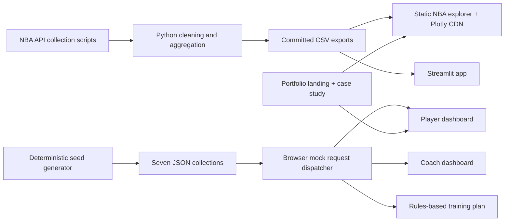
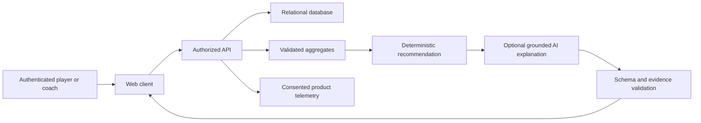

# PlusMinus Analytics — turning shot data into a next step

## Overview

PlusMinus combines an existing historical NBA analytics pipeline with a new training-product prototype. The technical question is whether a small, traceable data model can support a useful observation-to-practice loop. The product question is whether that loop helps a player choose a next action. This portfolio demonstrates the first at mock scale; the second needs user research.

## Starting point and intervention

The repository already contained a Python pipeline, NBA CSV exports, a Streamlit app, and a seven-page static analytics explorer. The documentation directed reviewers toward Tableau, although no workbook was committed. The proposed résumé also described training and AI capabilities absent from the code.

The work aligned claims and artifacts: a portfolio landing page provides an entry point; Training Lab demonstrates player progress, a coach roster and practice plans; a seeded seven-entity mock store makes the relationships inspectable; product specifications distinguish implemented behavior from future work. An audit also found and repaired an era-classification defect that grouped shots by home team.

## Architecture: implemented

The static deployment serves HTML, CSS, JavaScript, JSON, CSVs and documents. Browser calls to `mockRequest()` mimic API contracts but do not send `/api` HTTP requests. Plans are computed in memory and can be downloaded; refreshing does not preserve changes. Historical NBA data and fictional practice data are separate sources and never joined.

## Architecture: proposed production direction

This is an architectural proposal, not deployed infrastructure. Video ingestion would need a separate consent, storage, labeling and model-evaluation design.

## Decisions and tradeoffs

| Decision | Reason | Cost / limitation |
|---|---|---|
| Static prototype | Fast review, low operational setup, portable artifact | No authenticated writes or durable sessions |
| Deterministic synthetic fixture | Reproducible demos and tests without personal information | Cannot validate adoption, model quality or real-world outcomes |
| Rules before AI | Explainable output with inspectable inputs | No learned personalization or technique diagnosis |
| Named entities and API contracts | Clear path from UX to an eventual backend | Mock contracts do not prove backend scalability |
| Preserve NBA explorer | Demonstrates real data transformation and spatial analysis | Selected-player coverage and external Plotly dependency |
| Descriptive shooting index | Directly traceable to makes and attempts | Same information as session FG%; not a separate measure of skill |

## Evidence and outcomes

Implemented artifacts: three training dashboards containing 15 numbered charts, five simulated route contracts, seven related collections with 3 players, 24 sessions and 1,440 shot events, an explainable plan generator, and the product/strategy documentation. These are output counts, not business outcomes. See VERIFICATION.md for the checks actually completed.

The era correction is a concrete example of data-quality judgment: plausible-looking charts are not sufficient evidence of correct grouping. Explicit season metadata now wins over date inference, tests cover compact NBA season IDs and the 2020 bubble, and committed era aggregates are rebuilt from corrected rows.

No claim is made for model accuracy, shot-detection accuracy, validated player improvement, retention, revenue, recruiter engagement lift or production scale. The original estimated 3× engagement statement has no supporting baseline and should not appear on the résumé.

## Next decision

Observe five adult players or coaches using the prototype. Can they identify the suggested focus, explain why it was selected, and decide whether to use the plan? If fewer than four can do so unaided, improve the task and explanation before expanding the technology stack.

## Portfolio authorship and discussion

This is an independent portfolio project developed with AI coding assistance. The repository history and tests are the evidence for implementation; the owner should be prepared to explain and modify the model, calculations, error handling and product tradeoffs in an interview. User research and business outcomes are proposed work, not prior accomplishments.
