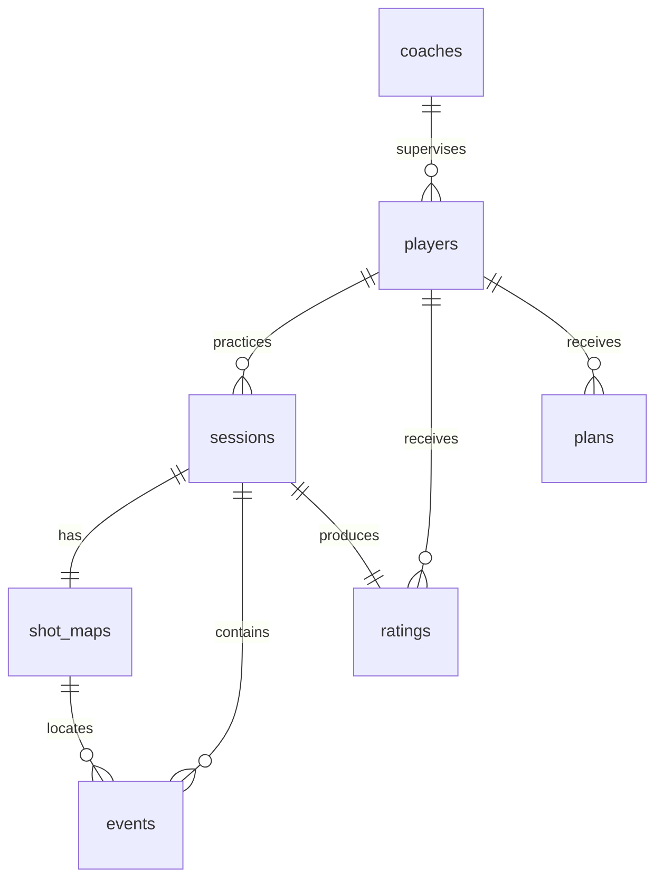

# Data model, API contracts and analytics inventory

## Two separate data products

The NBA explorer reads committed CSV exports from `public/data/`, mirrored in `data/exports/`. The master shot sample contains 79,763 rows for ten players, with observed game dates November 1, 1996–February 23, 2026. This is an exported, selected-player sample; completeness and collection time are not established by the date range. NBA data is not training data for the fictional players. Review data-provider terms before commercial redistribution.

Training Lab reads `public/prototype/db.json`, generated by `node scripts/seed.mjs` with seed 42. All training identities, shots and sessions are synthetic. The mock database consists of seven related JSON collections. `schema.sql` defines a corresponding SQLite schema, and `mock.sqlite` is a populated, inspectable database artifact built by `python scripts/build_mock_db.py`. The prototype does not connect to SQLite at runtime.

## Entity dictionary

| Entity | Rows | Key and relationships | Meaning |
|---|---:|---|---|
| coaches | 1 | `id` PK | Fictional coach and squad |
| players | 3 | `id` PK; `coach_id` → coaches | Name and position |
| sessions | 24 | `id` PK; `player_id` → players | Eight dated practices per player and duration in minutes |
| shot_maps | 24 | `id` PK; unique `session_id` → sessions | One map per session, coordinate system and synthetic provenance |
| events | 1,440 | `id` PK; `session_id` → sessions; `shot_map_id` → shot_maps | Each attempt: zone, x/y in feet from hoop, boolean made |
| ratings | 24 | `id` PK; `player_id` → players; unique `session_id` → sessions | Session shooting index = makes / attempts × 100 |
| plans | 3 | `id` PK; `player_id` → players | Initial 30-minute rule plans with explanation and drill array |



Storage invariants: unique IDs; event map and session agree; rating player owns its session; outcomes are boolean; plan minutes are integer 15–60; drill allocations sum to total. Tests validate the fixture and contracts. The SQL schema uses composite foreign keys to protect cross-entity ownership. A runtime backend would still need authentication, authorization, migrations and transactional writes.

The rating is deliberately a descriptive shooting index, not a validated estimate of basketball skill. It duplicates session FG% on a 0–100 scale. Repeated sessions need not demonstrate improvement: random sampling affects small samples.

## Five simulated API endpoints

These are **method/path contracts executed by `mockRequest(db, method, path, body)` in JavaScript**. They are not public HTTP routes. Running curl against `/api/players` on the static site returns 404. The browser inspector executes the contracts and shows the result. No response mutates db.json.

| Method / path | Required input | Success | Failure |
|---|---|---|---|
| GET `/api/players` | None | 200, `data: Player[]` | Unsupported method 405 |
| GET `/api/sessions?player_id=p1` | Existing player ID | 200, `data: Session[]` | Missing ID 400; unknown player 404 |
| GET `/api/shot-maps?player_id=p1` | Existing player ID | 200, `data: {maps, events}` | Missing ID 400; unknown player 404 |
| GET `/api/ratings?player_id=p1` | Existing player ID | 200, `data: Rating[]` | Missing ID 400; unknown player 404 |
| POST `/api/plans` | `{player_id: 'p1', minutes: 30}` | 201, `data: Plan` | Invalid duration / insufficient evidence 400; unknown player 404 |

All unknown paths return `{status: 404, error: 'Route not found'}`; unsupported methods on known routes return 405. Error responses contain `error` rather than `data`. The 201 status simulates resource creation; the returned plan is transient. Missing minutes uses the model's default of 30; string, fractional or out-of-range minutes are rejected.

Example:

```javascript
mockRequest(db, 'POST', '/api/plans', { player_id: 'p1', minutes: 30 });
// { status: 201, data: { id, player_id, minutes, engine, focus, explanation, drills } }
```

## Fifteen chart definitions

| # | Dashboard / chart | Calculation / scope |
|---|---|---|
| 01 | Player: session accuracy | Made / attempts × 100 per session |
| 02 | Player: attempts by session | Count of events per session |
| 03 | Player: zone accuracy | Made / attempts × 100 by zone across all sessions |
| 04 | Player: shot map | Latest session event coordinates; circle made / cross missed |
| 05 | Player: shooting index | Stored per-session descriptive rating |
| 06 | Coach: roster accuracy | Event-weighted FG% per player |
| 07 | Coach: practice volume | Total attempts per player |
| 08 | Coach: latest vs first | Last-session FG% minus first-session FG%, percentage points |
| 09 | Coach: time invested | Sum of session minutes per player |
| 10 | Coach: player × zone matrix | All-session FG% by player and zone, shaded cells |
| 11 | Training: target gap | max(0, 60 − zone FG%); illustrative target, not a normative benchmark |
| 12 | Training: practice distribution | Zone attempts / all attempts × 100 |
| 13 | Training: cumulative accuracy | Cumulative makes / cumulative attempts × 100 |
| 14 | Training: made vs missed | Total event outcomes by result |
| 15 | Training: practice allocation | Drill minutes in currently generated plan |

All charts derive from the same fixture and computations. Charts 01 and 05 deliberately show the same underlying measure; do not count them as independent validated dimensions of skill. Coach views always show the full roster; selected player controls the player/training views and API inspector.

## Known limits and provenance

Fixture generation fixes 60 attempts per session and 15 attempts per zone. Equal volume is intentional for demonstrability, not representative behavior. No sampling weights, opponent adjustments or confidence estimates are applied. A 20-attempt eligibility threshold is a product heuristic, not statistical validation. Recommendation ranking uses all sessions with no recency decay.

Historical era repair prefers season metadata; date inference uses a July boundary and a 2020 bubble exception. A production refresh should retain authoritative season IDs rather than infer them. The original CSV collection timestamp is unknown; the static sample does not auto-refresh.
