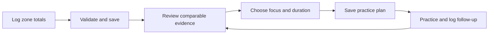

# PlusMinus Practice — focused MVP PRD

Status: proposed next release, not implemented. Prepared October 10, 2026.

This document narrows the next product release from the broader Training Lab vision. The existing prototype, mock store and roadmap remain useful portfolio evidence; they do not establish real-user validation.

## 1. Product decision

Build a mobile-friendly practice journal that helps an adult recreational basketball player **log a shooting session, choose an evidence-informed practice focus, and review a comparable follow-up session**.

Product promise: “Know what you practiced, choose what to work on next, and see what changed.”

Primary user: an adult recreational player who practices independently at least once a week and currently relies on memory or a notebook. Coaches are pilot reviewers, not a separate account role in the first release. Start with one user and one repeatable workflow; retain the coach dashboard as a labeled demo until coach demand is validated.

Problem hypothesis: recording results is easy enough, but remembering comparable results and deciding on a next practice is inconsistent. This hypothesis needs interviews and observed use. Recruiters can assess engineering and product judgment, but recruiter interest is not evidence of player demand.

## 2. Core experience

1. Try the synthetic demo without an account.
2. Create an account to save personal practice data.
3. Select a practice focus and use a repeatable spot-up shooting protocol.
4. Enter makes and attempts by zone after practice; review and save.
5. View session accuracy, sample size and comparable prior results.
6. Choose a 15, 30 or 45-minute practice plan; review the rationale and save it.
7. Log the next session against that plan and inspect the change.

The product succeeds when a real user completes this loop again. Adding more charts alone is not an MVP outcome.

## 3. Release scope

| Capability | Must ship | Acceptance criteria |
|---|---|---|
| Demo and real-data separation | Clearly labeled guest demo and authenticated personal workspace | Demo records never appear in personal totals; no real-account writes from demo mode |
| Account and ownership | Sign in/out; one player profile per account | Unauthenticated writes rejected; one account cannot read, edit or delete another account's records, including guessed IDs |
| Manual session entry | Date, duration, protocol, focus, zone-level makes and attempts | Integer counts; 0 ≤ makes ≤ attempts; positive duration; at least one attempted shot; save confirmation; refresh preserves saved data |
| Reliable saving | Server validation, database transaction and duplicate-submit protection | Retrying the same save does not create duplicate sessions; failed save keeps the form and explains retry |
| History and corrections | List, inspect, edit and delete own sessions | Corrections recompute aggregates; deletion has explicit confirmation; affected plan evidence is marked outdated |
| Session review | FG%, counts, zone distribution and comparable history | FG% = total makes / total attempts, not average of percentages; zero attempts displays “No attempts”; comparisons use matching zone and protocol |
| Practice plan | User-selected focus, duration, bounded drill library and evidence summary | Plan can be saved and reopened; allocated minutes equal selected duration; no claim that it diagnoses technique or guarantees improvement |
| Follow-up loop | Optional originating-plan ID on a new session | Show linked follow-up and percentage-point change for comparable results; incomplete or unmatched sessions remain clearly labeled |
| Pilot measurement | Minimal account-level activity records | Record successful server saves, saved plans and follow-ups; deduplicate retries; keep product telemetry separate from basketball records |

**Defer:** coach accounts/rosters, social feeds, payment flows, native mobile apps, video uploads, automatic shot detection, validated skill ratings, NBA-player similarity scores, live NBA refresh and generative AI. The historical NBA explorer remains a separate portfolio experience.

## 4. Five screens

| Screen | Primary action | Important states |
|---|---|---|
| Welcome / sign-in | Try demo or start personal journal | Demo disclosure; authentication failure |
| My practice | Start a session; inspect history | First-session onboarding; loading; no recent sessions |
| Log practice | Enter zone totals and save | Inline validation; unsaved draft; duplicate submit; failed request |
| Session review | Inspect evidence and choose next practice | No comparable baseline; low sample; edited session |
| Next practice | Save/reopen plan and log follow-up | No evidence yet; current plan; outdated evidence; follow-up linked |

## 5. Data and recommendation rules

### Capture honestly

The first release captures **zone totals**, not individual shot coordinates. Each zone result stores zone, makes and attempts. Do not expand a 12/20 entry into 20 invented events or plot fabricated locations. Display zone shading/bars rather than a point map for manually entered totals. Existing event-level synthetic maps remain in demo mode.

Start with the four existing zones: Paint, Mid-range, Corner 3 and Above-break 3. Use a fixed protocol label such as `spot_up_v1` and a short written setup. Log different drill types separately or mark them non-comparable. A minimum of two comparable sessions is needed to show a trend; it still does not establish statistical improvement.

### Focus is a user decision

The current prototype chooses the lowest raw zone FG%. That tends to choose harder shots and should not be presented as detecting a player's largest weakness. In this MVP, the player selects a focus; the system supplies the relevant evidence and a practice structure. A later coach-reviewed model may suggest goals using zone-specific expectations.

Use the latest three matching-protocol sessions within 30 days for the selected focus. Display the exact window, makes and attempts. If fewer than 20 attempts exist, offer a baseline practice and label the evidence insufficient for a progress interpretation. Twenty attempts is a usability heuristic, not a confidence threshold.

With sufficient data, select a focus drill from a small versioned library reviewed by a basketball coach before pilot use. Allocate 20% to warm-up, 60% to focus and the remainder to review, using integer minutes that sum exactly. Store the chosen drill versions, source session IDs, evidence snapshot and rules version with the plan. Changing source data marks its plan evidence outdated; it must not silently rewrite an old recommendation.

## 6. Backend and model changes

Keep the existing static portfolio and demonstration available. Add a small authenticated application with a server API and a relational database. Choose managed authentication and persistence at implementation time; provider selection does not change the PRD.

Core records:

- Account identity and player profile, linked by an enforced owner ID.
- Sessions: player, date, duration, protocol and optional originating plan.
- Zone results: session, zone, makes and attempts; unique per session/zone.
- Plans: owner, focus, duration, evidence snapshot, source IDs, rules version and status.
- Plan items: plan, versioned drill ID, order and minutes.

Aggregate statistics should be calculated from saved results. A separate ratings table is unnecessary until a rating has a useful, validated definition. Coach and shot-map tables are not needed for personal zone-total logging. Do not preserve an arbitrary seven-entity count at the expense of a clearer model.

Suggested authenticated API surface:

| Route | Behavior |
|---|---|
| GET `/api/me` | Read own profile; authentication provider handles login |
| GET/POST `/api/sessions` | List own history or atomically save session plus zone totals |
| GET/PATCH/DELETE `/api/sessions/:id` | Read/correct/remove an owned session |
| GET `/api/analytics?protocol=spot_up_v1` | Return owned aggregates, counts and comparable history |
| GET/POST `/api/plans` | List saved plans or create a versioned plan from owned evidence |
| GET `/api/plans/:id` | Read own plan, its rationale and linked follow-ups |

Use 400 for validation failures, 401 for unauthenticated requests, 404 for missing or non-owned resource IDs, and 409 for conflicting update versions. Save requests carry a unique idempotency key. The server derives ownership from the authenticated account rather than trusting a supplied player ID. No request may reference another owner's session or plan.

## 7. Quality and release gates

- Persistent save → reload → review → plan → follow-up passes in the deployed environment.
- Integration tests verify ownership on every resource route, cross-owner reference rejection, transaction rollback, duplicate saves, corrections and plan evidence invalidation.
- Unit tests cover weighted FG%, empty zones, sparse evidence, the 30-day window, protocol matching and minute totals.
- Mobile and keyboard checks cover all five screens; status/errors are announced; charts have accessible values.
- No API credentials in client code. Collect only the profile information needed for practice records; keep the pilot adult-only and omit video and health information.
- Measure the review screen against a proposed target of under three seconds with 100 sessions on a defined mobile/network test profile. Report the actual result; it is not currently measured.
- Complete a signed-out and two-account smoke check on the published URL. Local tests alone do not establish a working release.

## 8. Validation and success measures

Begin with five observed usability sessions, then a four-week pilot with 5–10 adult players. Counts and thresholds below are initial decision rules, not existing outcomes or statistically conclusive evidence.

| Question | Measure | Initial gate |
|---|---|---|
| Can someone use it? | Complete zone entry, save and locate the plan unaided | At least 4/5 observed participants |
| Is logging tolerable? | Time to enter prepared four-zone totals, excluding basketball practice | Median ≤90 seconds in the observed test |
| Is the plan understood? | Participant identifies focus, evidence and limits in their own words | At least 4/5 |
| Does anyone return? | Saved a plan and a linked follow-up within seven days / participants who saved a plan and have seven days of observation | At least half; report exact counts |
| Are records trustworthy? | Reconciliation and ownership tests | All release checks pass; zero known cross-account exposure |

Track `session_saved`, `plan_saved` and `followup_saved` from successful server operations. Product usage does not establish improved basketball ability. Measuring skill change requires a consistent protocol and an appropriate study design.

If participants do not return, investigate capture effort and plan usefulness before building AI. If coaches prove more motivated than individual players, run a coach-workflow discovery round before changing account roles.

## 9. Implementation sequence

These are effort estimates for a solo developer familiar with the chosen stack, not delivery commitments. User feedback and hosted-service setup can extend them.

| Milestone | Work | Exit |
|---|---|---|
| First 2–3 focused days | Personal logging form, server/database/auth foundation and persisted session review | One real account saves a session and sees it after reload; the existing demo remains shareable |
| Next 2–3 days | History, edits, deletes, owned analytics and idempotency | Reliable record lifecycle with two-account tests |
| Next 2–3 days | Saved plans, evidence snapshots and linked follow-up | Complete practice loop, including stale-evidence handling |
| Next 1–2 days | Deployment checks, mobile review and usability preparation | Pilot-ready release with measured checks and a short recording |
| Following four weeks | Small pilot and weekly interviews | Decide whether to improve capture, add coach workflow or pursue an AI experiment |

If only a few days are available, ship the first vertical slice and describe it as a **practice logging beta**. Do not label the entire PRD complete until the practice loop works.

## 10. When AI earns a place

After the core loop works, test an optional explanation feature that turns stored evidence and approved drill descriptions into plain-language coaching context. The model may explain an existing recommendation; it must not invent statistics, diagnose technique from totals or promise improvement. Require numeric fidelity, valid structured output and a deterministic fallback, using the evaluation gates in PRODUCT_SPEC.md. An AI feature is valuable only if users understand or act on the plan more effectively.

## 11. Portfolio demonstration

The strongest final demo is: “I saved a real session, reloaded it, reviewed its evidence, saved a practice plan, and recorded a comparable follow-up.” Accompany it with the deployed URL, architecture, ownership tests and pilot findings. This provides evidence of a complete product workflow beyond the existing mock dashboards.
