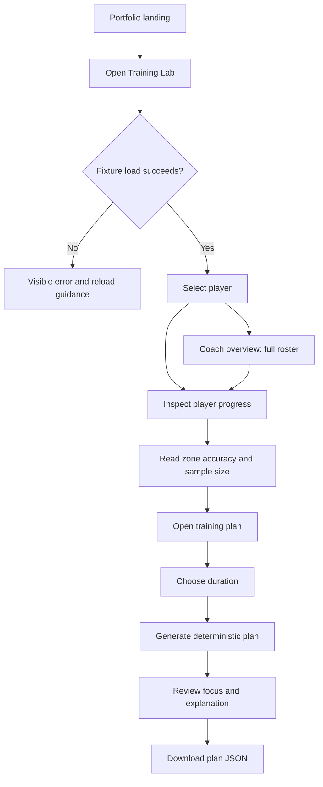

# PlusMinus Training Lab — PRD, blueprint and UX flows

Version 1.0 · October 10, 2026 · Portfolio prototype, not a launched business.

## Product brief

Help a developing basketball player answer: **What should I practice next, and what evidence supports that choice?** The existing NBA explorer demonstrates spatial analysis. Training Lab applies the same observation-to-decision pattern to fictional practice data.

Primary audience hypothesis: adult recreational players practicing independently. Secondary audience: independent coaches supervising a small roster. Recruiters are the audience for this demonstration, not a substitute for product users. No interviews or willingness-to-pay results are claimed.

Job to be done: after a practice session, identify a weak shooting zone and leave with a manageable next session. Hypothesis: a short explanation tied to shot counts is more actionable than a dashboard alone.

## Scope and success criteria

**Implemented prototype:** select a fictional player; inspect eight sessions; review accuracy by zone and location; switch to a coach roster; generate a 15–60 minute rule-based plan; download it; inspect five simulated API contracts.

**Next MVP:** manual session logging, durable storage, authenticated ownership, coach review, session-to-plan-to-session history. **Later experiments:** video-based shot tracking, calibrated skill ratings, and grounded AI explanations. Not in this prototype: authentication, live camera capture, medical advice, real AI inference, payments, validated skill scores, or real user outcomes.

Prototype release gates: all three dashboards render; 15 charts reconcile with the seed data; no cross-player mixing; plan minutes sum to the selected duration; unknown players and invalid payloads receive defined errors; synthetic-data labeling is visible; keyboard access and narrow-screen layout are checked.

Pilot product gates are hypotheses: at least 4 of 5 observed participants find their weakest zone and explain their next plan without help in two minutes; no participant mistakes simulated ratings for an externally validated assessment. Failure means revise the explanation or workflow before adding features.

## Feature blueprint

| ID | User story / priority | Inputs and output | Acceptance criteria | Status |
|---|---|---|---|---|
| F1 | As a player, inspect my progress / P0 | Player ID → sessions, makes, attempts, FG% | Changing player updates all five player charts and summary; no empty denominator shown as 0% | Implemented with fixtures |
| F2 | As a player, locate weak zones / P0 | Shot events → four zone aggregates and latest-session map | Makes and misses have distinct shapes; counts reconcile; chart values accessible | Implemented |
| F3 | As a coach, compare a roster / P0 | Three players → five roster charts | Selector behavior explained; change shown in percentage points; no causal improvement claim | Implemented |
| F4 | As a player, get a practice plan / P0 | Player, duration → focus, evidence, three drills | Minimum 20 attempts in an eligible zone; lowest FG% wins; deterministic tie break; minutes sum exactly | Implemented rules |
| F5 | As a reviewer, inspect feasibility / P0 | Five method/path contracts → status and JSON | 400/404/405 errors defined; simulated execution prominently labeled | Implemented |
| F6 | As a player, log a real session / P1 | Manual attempts and outcomes → stored session | Reject invalid coordinates and duplicates; ownership enforced; edits auditable | Proposed |
| F7 | As a player, understand my rating / P1 | Sufficient sessions → calibrated score and confidence | Define sample thresholds, holdout comparison and calibration before a skill claim | Research required |
| F8 | As a player, get an AI explanation / P2 | Aggregated evidence → constrained explanation | Cite supplied metrics, no invented stats; deterministic fallback; pass evaluation gate | Proposed |
| F9 | As a player, track shots with a camera / P2 | Consented video → detected attempts | Measure precision/recall against human labels across devices and lighting; allow correction | Proposed |

## UX flows

**Prospective real-player journey:** create account → establish consent and ownership → manually log practice → validate attempts → persist session → inspect metrics → review plan → complete practice → log follow-up. This journey is not implemented in the demo.

**States:** loading uses a visible status; failed fixture fetch displays retry guidance; unsupported API methods return 405; unknown players return 404; absent IDs and invalid durations return 400. Insufficient plan data returns 400 with a sample requirement. Seed data has no empty-player UI scenario; a production implementation must add first-session onboarding and suppress unavailable charts.

## Recommendation and AI boundary

Current rule: retain zones with at least 20 attempts, sort by ascending FG%, break ties alphabetically, allocate floor(60% of time) to that zone and floor(20%) to warm-up, with the remainder to mixed review. It uses all eight sample sessions; recency weighting is intentionally absent. Low accuracy alone does not diagnose technique or prove the highest-value intervention.

Proposed AI addition should verbalize a validated recommendation, not invent new metrics. Supply aggregates and permitted drill IDs, require structured output, validate it, and fall back to a rule explanation. Before launch, evaluate at least 50 predefined cases including sparse data, ties, extreme values and adversarial input. Proposed gates: 100% numeric fidelity and valid output, at least 90% coach-rated relevance, and no unsupported performance guarantees. These are targets, not current results.

## Requirements beyond the prototype

Persist records with foreign keys and deletion rules; enforce coach/player access on the server; minimize personal data; define retention before collecting video; instrument consented product events; budget latency and cost before model selection. Target prototype load under three seconds on a typical connection remains unmeasured. Browser performance should be measured separately from correctness.
