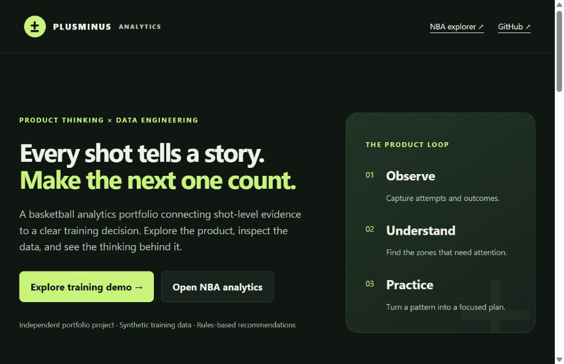
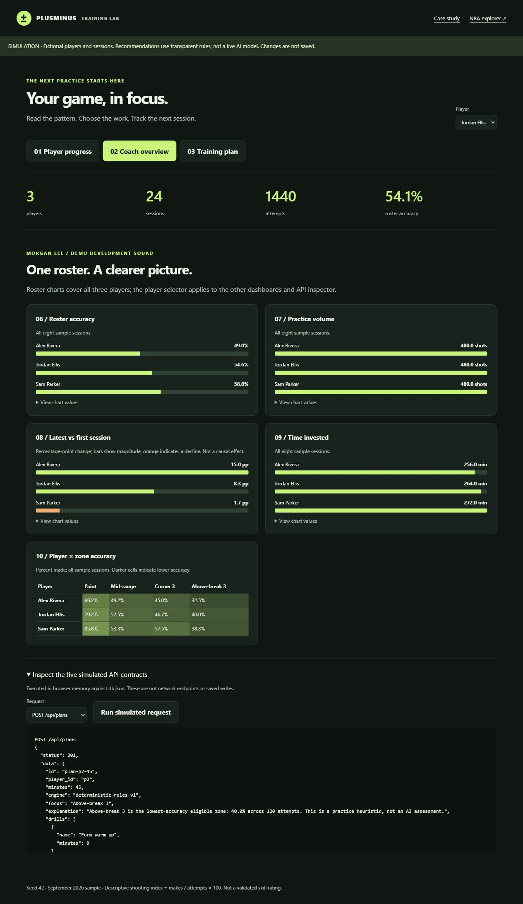
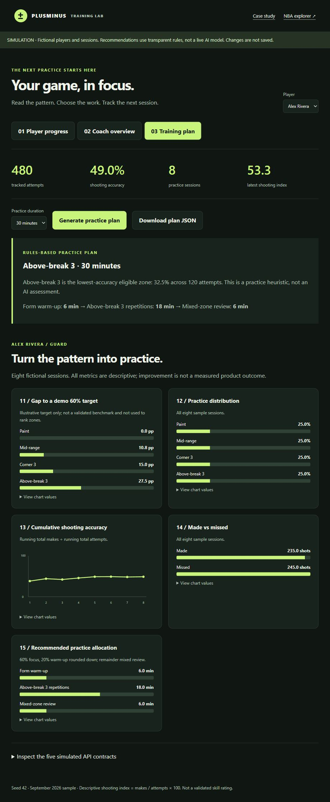

# Verification report

Verified locally on October 10, 2026. This report does not certify a production deployment.

**Story:** recruiter opens portfolio → selects fictional player → reviews shot evidence → generates a duration-specific plan → downloads JSON and inspects the simulated API contract.

| Boundary | Result | Evidence |
|---|---|---|
| Static entry and navigation | Passed | Landing page opens in the browser and links to Training Lab and the NBA explorer |
| Fixture → model | Passed | Node tests validate seven collections, unique keys, foreign keys, rating ownership, 1,440 outcomes and metric reconciliation |
| Model → plan | Passed | Each player at 15/30/45/60 minutes chooses the lowest eligible zone; drill minutes sum exactly; invalid and sparse inputs rejected |
| Simulated route contracts | Passed | Tests exercise all five contracts plus missing ID, unknown ID, invalid duration, unknown route and wrong method |
| Browser player → plan | Passed | Jordan Ellis: 54.6% overall accuracy; Above-break 3 focus at 40.0% across 120 attempts; 45-minute plan allocates 9/27/9 |
| Download | Passed | Browser downloaded `plan-p2-45.json`; file contents matched the displayed plan |
| Browser API inspector | Passed | GET players returned 200 with three players; POST plan returned 201 and the selected 45-minute plan |
| Three dashboard renders | Passed | Player charts 01–05, coach charts 06–10, training charts 11–15 rendered; coach roster includes negative percentage-point change |
| Browser runtime | Passed for observed path | No warning/error entries reported by browser logs on the tested prototype and era paths |
| Narrow viewport | Passed for observed path | Requested 390px viewport; reported content/client widths both 375px after scrollbar; no horizontal page overflow on coach/training views |
| SQLite artifact | Passed | Seven populated tables; integrity check `ok`; zero foreign-key violations |
| Historical era repair | Passed | Four regressions cover explicit IDs, dates, invalid inputs, bubble season and frontend coverage; six era buckets visibly render |
| Existing comparison pipeline | Passed | Zone aggregation, grid aggregation and comparison fixture passed under Python UTF-8 mode |

## Commands

```sh
node --test tests/prototype.test.mjs
python -m unittest discover -s tests -p test_eras.py
python -X utf8 test_comparison_pipeline.py
python scripts/build_mock_db.py
node --check public/prototype/app.mjs
node --check public/app.js
```

The initial Windows comparison-test run failed while printing a checkmark under cp1252, after a passing assertion. Running in UTF-8 mode resolved the console-encoding issue. The initial local preview was inaccessible across sandbox networking; a permitted preview server outside that boundary enabled browser verification. Neither issue required changing product behavior.

## Screenshots







[Mobile training capture](screenshots/training-mobile.png)

## Limits

No public deployment, authentication, real backend API, live AI, camera capture, performance benchmark, full accessibility audit, or user study was verified. The Streamlit UI was not launched; its era label list was updated and checked for coverage. The NBA shot and era views were browser-smoke-tested; the other existing NBA pages were not exhaustively retested. Review artifacts and practice the explanation before sharing résumé claims.
